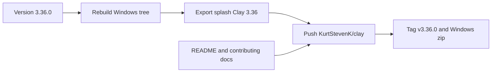

# Clay 3.36 release

Clay is already a rebranded GIMP 3.3.1 tree (`version: '3.3.1'` in [meson.build](meson.build), binary `clay-3.3.exe`). The splash image still says **Clay 3.3**, with the subtitle **CLAY IMAGE MANIPULATION PROGRAM**. The red 6 in the screenshot is a markup on that picture, not text in the file. The git remote is still `https://gitlab.gnome.org/GNOME/gimp.git`. Nothing will be pushed there.

## Name

The product name becomes **Clay Image Beautification Program**. Short name stays **Clay**.

Change the user-facing string only. File headers that say `GIMP - The GNU Image Manipulation Program` stay as they are; those name the upstream work, not this app.

- [meson.build](meson.build) `full_name`
- [app/about.h](app/about.h) `GIMP_NAME` (window title, About dialog)
- [desktop/gimp.desktop.in.in](desktop/gimp.desktop.in.in) `Name=`
- The two hardcoded copies in [app/gui/gui-vtable.c](app/gui/gui-vtable.c) and [app/actions/documents-commands.c](app/actions/documents-commands.c)
- Splash subtitle, via [gimp-data/images/export-splash.py](gimp-data/images/export-splash.py): replace `CLAY  IMAGE  MANIPULATION  PROGRAM` with `CLAY  IMAGE  BEAUTIFICATION  PROGRAM`

`BEAUTIFICATION` is longer than `MANIPULATION`. After export, if the subtitle no longer fits on one line under the wordmark, reduce that text layer’s size or letter-spacing in the splash XCF and export again.

## About dialog and Help menu

From the running German UI:

- Help submenu **GIMP im Internet** becomes **Clay im Internet**. Source label in [menus/image-menu.ui.in.in](menus/image-menu.ui.in.in) changes from `_GIMP Online` to `_Clay Online`, and the German string in [po/de.po](po/de.po) changes with it. The Windows About item **Über GIMP** becomes **Über Clay** (`About GIMP` in [app/actions/dialogs-actions.c](app/actions/dialogs-actions.c), plus that German translation).
- **Visit the Clay website** in [app/dialogs/about-dialog.c](app/dialogs/about-dialog.c) opens `https://claydesign.web.app`. The same URL replaces `https://www.gimp.org/` on Help → Clay Online → Main Web Site in [app/actions/help-actions.c](app/actions/help-actions.c). Bug reports and the developer link in that menu point at `https://github.com/KurtStevenK/clay` instead of GNOME GitLab. The user-manual link stays on `docs.gimp.org` until Clay has its own manual.
- About copyright line in [app/about.h](app/about.h) becomes **© 2026** and **Kurt Steven Kunzlmayer | Spencer Kimball of this fork.** The `1995-%s` year range and “Peter Mattis and the Clay Development Team” leave the About dialog only.
- Source file headers, `COPYING`, and the README still name Spencer Kimball, Peter Mattis, and the GIMP contributors. Those notices stay with the code.

## Empty canvas

Remove the centered **Unstable Development Version** overlay in [app/display/gimpdisplayshell-callbacks.c](app/display/gimpdisplayshell-callbacks.c) (the German text “Instabile Entwicklungsversion”, the commit hash, and the “check git master” line). It is not replaced with “you’re welcome”. Version 3.36.0 would already hide it, because that block is compiled only for an unstable version; deleting it keeps it off this fork.

## Version

Set the Meson project version to **`3.36.0`**.

GIMP’s splash export prints `major.minor`, so this is what makes the title **Clay 3.36** in the same typeface as the rest of the wordmark. It also makes About, the welcome dialog, and the Windows binary say 3.36 (`clay-3.36.exe`). Micro `0` is an even release number, so the build stops calling itself a development snapshot.

These stay as they are:

- API and plug-in directory stay `gimp-3.0` (`share/gimp/3.0`, `lib/gimp/3.0`). A 3.36 minor must not move the API.
- Meson project name stays `gimp`, so the existing Windows build keeps configuring.

Fork-only identity fixes in [meson.build](meson.build):

- User config folder becomes `%APPDATA%\Clay\3.36` (default `gimpdir` to `Clay`). This is a new profile, separate from both official GIMP and the current `GIMP\3.3` folder.
- Single-instance mutex stays `3.36` on this stable number. Upstream would otherwise collapse an even minor to mutex `3`, which is the same lock as GIMP 3.

Installer identity in [build/windows/installer/gimp-setup.iss](build/windows/installer/gimp-setup.iss): publisher, install folder, AppID, and mutex prefix become **Clay**, shortcuts point at `clay-3.36.exe`, and the displayed app name is **Clay Image Beautification Program**. The desktop and Start menu shortcut label stays **Clay 3.36** so the icon name stays short. Today that script still says GIMP and would treat a stable build as GIMP 3.

Update the local [start-clay.bat](start-clay.bat) launcher to `clay-3.36.exe`. Leave it untracked; it only launches the local `_install` tree.

## Splash

After the new binary exists, regenerate [gimp-data/images/gimp-splash.png](gimp-data/images/gimp-splash.png) with [gimp-data/images/export-splash.py](gimp-data/images/export-splash.py). That script rewrites the XCF text to **Clay 3.36** and the subtitle **CLAY IMAGE BEAUTIFICATION PROGRAM**. The PNG is then installed to `_install/share/gimp/3.0/images/gimp-splash.png` so the next launch shows it.

Keep the nebula artwork and whatever credit is already on that splash. The README will name it as a fork of GIMP and keep the GPL and upstream art credit. Clay is not presented as the official GIMP.

## Docs

New GitHub-facing files, without deleting upstream `README`, `COPYING`, `LICENSE`, or `AUTHORS`:

- [README.md](README.md) — Clay Image Beautification Program, GPL-3.0-or-later, credit to Spencer Kimball, Peter Mattis, and the GIMP contributors, link to the tag, and platforms
- [CONTRIBUTING.md](CONTRIBUTING.md) — pull requests to this fork, keep existing copyright headers, follow the surrounding code style
- [CODE_OF_CONDUCT.md](CODE_OF_CONDUCT.md)
- [SECURITY.md](SECURITY.md) — report security issues on this repo, not to the GIMP team

Platform wording in the README:

- **Windows, Linux, and macOS** are supported desktop targets. This source already has [build/windows](build/windows), [build/linux](build/linux), and [build/macos](build/macos). Clay 3.36 publishes a Windows build. Linux and macOS are built from the same tree; this machine will not cross-compile them.
- **Mobile, coming later:** iOS, Android, Huawei, and Microsoft. No mobile code in this release.

Add a short Clay 3.36 note at the top of [NEWS](NEWS).

## GitHub

Account: **KurtStevenK** (the active `gh` login). New **public** repo `KurtStevenK/clay`, described as the Clay Image Beautification Program. There is no Clay repo yet.

History is about 1.3 GB. The largest blob is 64 MB, under GitHub’s 100 MB file limit, so a full-history push is the fork. The branch stays on the commit you have built (6 commits behind GNOME `master`). Those 6 commits are not pulled in this release.

- Rename the GitLab remote to `upstream` and point `origin` at GitHub.
- Push `master` only to GitHub.
- `gimp-data` is a 46 MB submodule with the Clay splash and logo still uncommitted, and it still points at GitLab. Fold that worktree into the Clay repo for this commit so a normal clone contains the splash. Do not commit `gimp-data/.git`.
- Add a root `.gitignore` for `_build/`, `_install/`, launch logs, and local preview junk. Those stay off the release.
- Tag `v3.36.0` and create a GitHub Release. Attach a zip of the Windows install prefix. Build the Inno installer only if the Inno compiler is already on the machine; the zip is the artifact either way.

