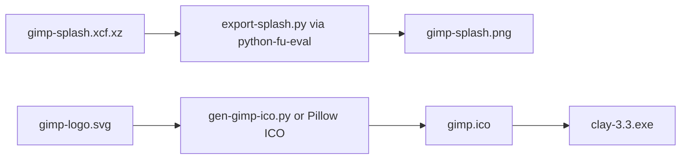

# Finish Clay splash and Windows icon

Cline’s last Clay task (`1792601701531`) was: *“change the start splash screen, there is in the image gimp so we need to cover that. as also the tray icon.”* Text branding in [`app/about.h`](app/about.h) is already Clay; the splash PNG and Windows `.ico` were not finished. Cline’s focus chain stopped after path lookup — it never ran the **Python** splash export (`python-fu-eval` / [`gimp-data/images/export-splash.py`](gimp-data/images/export-splash.py)).

The splash GIMP text is **not** drawn by [`app/gui/splash.c`](app/gui/splash.c). It is baked into the artwork:

- Source: [`gimp-data/images/gimp-splash.xcf.xz`](gimp-data/images/gimp-splash.xcf.xz)
- Build: Meson `custom_target` in [`gimp-data/images/meson.build`](gimp-data/images/meson.build) runs `clay`/`gimp_exe -nidfs --batch-interpreter python-fu-eval` with `export-splash.py`
- Installed copy: [`_install/share/gimp/3.0/images/gimp-splash.png`](_install/share/gimp/3.0/images/gimp-splash.png) — nebula photo with **GIMP 3.2** and **GNU IMAGE MANIPULATION PROGRAM** top-right

Windows taskbar/tray icon is the `.exe` resource, not a separate tray PNG:

```67:69:build/windows/gimp.rc.in
1	ICON	"gimp-data/images/logo/gimp.ico"
2	ICON	"gimp-data/images/logo/fileicon-xcf.ico"
3	ICON	"gimp-data/images/logo/fileicon.ico"
```

[`gimp-data/images/logo/gen-gimp-ico.py.in`](gimp-data/images/logo/gen-gimp-ico.py.in) is the (optional, `build_by_default: false`) GIMP Python path that rasterizes [`gimp-logo.svg`](gimp-data/images/logo/gimp-logo.svg) (Wilber) into `gimp.ico`.



## Approach (use Python; do not skip it)

### 1. Splash: extend GIMP Python-Fu, with Pillow fallback

Run `clay-3.3.exe` batch Python (same as Meson) to list text layers in the XCF. Then extend [`export-splash.py`](gimp-data/images/export-splash.py) (it already finds the `"RC"` text layer) to:

- Replace the **GIMP** wordmark layer with **Clay**
- Replace **GNU IMAGE MANIPULATION PROGRAM** with **Clay Image Manipulation Program** (same string as `GIMP_NAME` in [`app/about.h`](app/about.h))
- Leave the version text as-is or align it with the running 3.3 build

Rebuild/install only the splash target into `_install/share/gimp/3.0/images/`.

If those marks are raster (not `Gimp.TextLayer`), add a short Pillow script that:

- Samples the nebula under the top-right wordmark
- Covers **GIMP 3.2** + the GNU subtitle
- Draws **CLAY** + subtitle in white, similar weight/placement
- Writes the same installed PNG (and a source-side copy so the next install does not revert)

Meson currently regenerates splash from the XCF, so a PNG-only patch would be overwritten. Prefer the `export-splash.py` layer edit so rebuilds stay branded.

### 2. Taskbar/tray: new ICO, then relink the exe

Wilber-in-`gimp.ico` still reads as GIMP. Generate a simple Clay letter-mark ICO (dark field, white **C**, sizes used in `gen-gimp-ico.py.in`: 16–256) with Python (Pillow), write [`gimp-data/images/logo/gimp.ico`](gimp-data/images/logo/gimp.ico).

Then rebuild just the Windows resource + `clay-3.3.exe` so the taskbar updates (copying the `.ico` into `_install` is not enough). Launch with [`start-clay.bat`](start-clay.bat).

### 3. Verify

- Start Clay, confirm splash wordmark is Clay (no GIMP / GNU IMAGE MANIPULATION PROGRAM)
- Confirm taskbar/title-bar icon is the new ICO
- Confirm personal `gimp-splash.png` override in the user config dir is not hiding the install splash (splash.c loads that first)

Out of scope: full Wilber SVG redesign, installer BMPs, Linux/macOS icon themes, remaining in-app “GIMP” strings beyond this splash/icon task.
