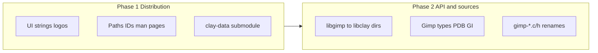

# GIMP → Clay full rebrand (phased)

## Current state

Partial Clay branding already exists in [meson.build](meson.build) (`prettyname`, `full_name`, `clay` executables/desktop WM class) and user-facing strings via [app/about.h](app/about.h) and several `app/` files. Most of the tree is still upstream GIMP: Meson `project('gimp')`, install paths under `share/gimp` and `lib/gimp`, pkg-config `gimp-3.0`, GObject `Gimp`, thousands of `gimp-*` sources, and [desktop/org.gimp.GIMP.appdata.xml.in.in](desktop/org.gimp.GIMP.appdata.xml.in.in) still describing GIMP.

---

## License and attribution (what you must / may do)

| Area | Requirement | Practical rule for Clay |
|------|-------------|------------------------|
| **GPL-3+ app core** ([COPYING](COPYING), [LICENSE](LICENSE)) | Forking and renaming is allowed. **§4–5**: keep copyright/license notices in source; **§5(a)**: state that the work was modified (date/project). Ship `COPYING` with binaries. | Add a top-level **NOTICE** or section in README: “Clay is a modified fork of GIMP (GNOME), not affiliated with the GIMP project.” Keep per-file `Copyright (C) …` headers; add “Clay Development Team” where you make substantive changes, do **not** strip Kimball/Mattis/GIMP authors. |
| **LGPL-3+ libraries** (`libgimp*/COPYING`) | Same attribution rules for library sources. | Phase 2 renames do not remove LGPL obligations; library copyright blocks stay. |
| **Trademark** (GPL §7(e) is about *withholding* trademark grants, not granting them) | Do not market the product as “GIMP”. | Product name **Clay** everywhere public. Optional search keyword “GIMP” in `.desktop` (already documented in [desktop/gimp.desktop.in.in](desktop/gimp.desktop.in.in)) is a UX choice, not a license requirement. |
| **CC BY-SA icon themes** ([LICENSE](LICENSE) lines 28–29, `gimp-data/icons/Legacy/COPYING`) | Modified icons must comply with BY-SA (share alike, attribution). | In **clay-data**, rename/replace Wilber/GIMP-branded artwork; keep COPYING/attribution files; document icon provenance. |
| **CC0 / data** | Low restriction on brushes/patterns per project policy. | Safe to rebrand paths/filenames; no need to erase historical author names in data metadata. |
| **Release notes** ([desktop/org.gimp.GIMP.appdata.xml.in.in](desktop/org.gimp.GIMP.appdata.xml.in.in)) | No GPL rule requiring verbatim upstream changelog text. | **Keep historical `<release>` entries** that describe GIMP 2.x/3.x as-is (upstream authors and “GIMP” naming). Add new `<release>` blocks for Clay versions with Clay wording. Update top-level `<name>`, `<description>`, URLs, `<developer_name>`, `<id>` for Clay. |

**Deliverable:** `NOTICE` + updated README stating license, derivation, and “modified version” per GPL §5(a).

---

## Phase 1 — Distribution, UX, and clay-data (ship first)

Goal: A user installing/running the app sees **Clay** only; config and data live under **Clay** paths; no requirement to rename `libgimp` yet.

### 1.1 Meson / install identity

Centralize branding in [meson.build](meson.build) (extend existing `prettyname` / `gimp_command` pattern):

- `project('clay', …)` and `project_url` / issue URLs → your Clay hosting (replace `gitlab.gnome.org/GNOME/gimp`).
- `gimp_api_name` / `project_subdir`: `gimp-3.0` → `clay-3.0` for `datadir`, `libdir` plug-in tree, `sysconfdir`.
- Default config dir: set `gimpdir` default to `Clay` (today empty → falls back to `meson.project_name().to_upper()` → `GIMP` at [meson.build](meson.build) ~1691–1697). Prefer changing default in [meson_options.txt](meson_options.txt) or hard-default after `project()` rename.
- `gettext_package`: `gimp30` → `clay30` (coordinate with `po/` / `po-*` `POTFILES` and `LINGUAS` workflow).
- Rename install artifacts still named GIMP: man pages (`gimp-3.3`), `gimprc` → `clayrc` in [etc/meson.build](etc/etc) and [etc/gimprc.in](etc/gimprc.in), bash completion, debug/tool binary names in `app-tools/` / `app/meson.build`.
- pkg-config **can stay `gimp-3.0` in Phase 1** intentionally so third-party plug-ins still build; document that Phase 2 will add `clay-3.0` (or switch).

### 1.2 Desktop / AppStream / packaging

In [desktop/](desktop/):

- Rename templates: `gimp.desktop.in.in` → `clay.desktop.in.in` (output already `clay.desktop` via `gimp_desktop_name`).
- AppStream: `org.gimp.GIMP.appdata.xml` → `org.clay.Clay.appdata.xml` (update [desktop/meson.build](desktop/meson.build) `appdatafilename`).
- Refresh component metadata: `<name>`, `
`, `<description>`, `<developer_name>`, `<url>`, screenshots (your URLs or local), `<translation>` → `clay30`.
- **Historical `<releases>`**: leave upstream GIMP text; prepend a Clay release entry for `3.3.x` describing the fork.
- Windows/macOS/Linux bundle scripts under `build/` that embed `gimp` in paths or product names.

### 1.3 Application strings and docs

- Grep-driven pass on `app/`, `plug-ins/` (user-visible only): remaining `_(`…GIMP…`)` / `g_printerr` / about text → Clay (build on work in [app/about.h](app/about.h)).
- Update [README](README), [devel-docs/README.md](devel-docs/README.md), [authors.xml](authors.xml) / about dialog pipeline for **Clay Development Team** while retaining upstream author list in About.
- Environment variables: **Phase 1** — keep `GIMP_*` env vars internally for less churn; add documented aliases (`CLAY_*`) only if needed for scripts. **Phase 2** — rename or dual-read.

### 1.4 Fork `gimp-data` → `clay-data`

Per your choice:

1. Fork [GNOME/gimp-data](https://gitlab.gnome.org/GNOME/gimp-data) to a Clay remote.
2. Update [.gitmodules](.gitmodules): path `clay-data`, URL your fork.
3. In submodule: rename `gimp-data/` references in root [meson.build](meson.build) (`subdir('clay-data')`, `check-gimp-data.py` → `check-clay-data.py` or generic name).
4. Rebrand assets: logos/splash ([gimp-data/images/logo/](gimp-data/images/logo/) today), hicolor `gimp.png` / `gimp.svg`, tip/tag XML filenames (`gimp-tips.xml` → `clay-tips.xml`) and meson install rules.
5. Replace or redesign Wilber; update desktop `Icon=` from `gimp` to `clay` once icons exist.

### 1.5 CI and verification

- Adjust [.gitlab-ci.yml](.gitlab-ci.yml) job names and expectations (`clay-*` binaries, install tree under `share/clay`).
- Verification (per [verification-before-completion](file skill)): clean Meson configure, full build, run `clay-3.3`, smoke test (open image, plug-in load), `appstreamcli validate` on new appdata, confirm config dir `~/.config/Clay/3.0` (or chosen layout).

**Phase 1 exit criteria:** Installed tree has no user-visible “GIMP” except intentional keywords/historical release notes; binaries and `.desktop` are Clay; data/icons from clay-data; GPL NOTICE in repo.

---

## Phase 2 — API, symbols, and filename rename

Goal: Source tree and public API match **Clay** naming; accept **breakage** of unmodified upstream GIMP plug-ins until ported.

### 2.1 Mechanical rename strategy (order matters)

1. **Top-level directories** (and all `subdir()` in [meson.build](meson.build)):
   - `libgimp` → `libclay`, `libgimpbase` → `libclaybase`, … `libgimpwidgets` → `libclaywidgets`.
   - `gimp-data` already `clay-data`.
2. **Meson variables**: systematic `gimp_*` → `clay_*` where they denote product/API (keep a short compatibility shim period if desired).
3. **Generated code first**: [pdb/](pdb/), `tools/gimp-mkenums`, enum `.pl` files — update templates then regenerate PDB and enum outputs (`libgimp/*_pdb.*`, `*enums.c`) so manual edits are not fighting generators.
4. **GObject / GI**: `Gimp` namespace → `Clay` in `.gir`/typelib names (`Gimp-3.0` → `Clay-3.0`); update Python plug-ins and `plug-ins/python` bindings.
5. **C symbols and types**: `GimpImage` → `ClayImage`, `gimp_*` functions → `clay_*` — use scripted renames with allowlists for false positives (`GEGL`, `gzip`, `agimp`, etc.).
6. **Filenames**: `gimp-*.c` / `gimp*.h` → `clay-*` / `clay*.h`; update `#include` and `meson.build` source lists (`git mv` batches by directory).
7. **pkg-config**: `gimp-3.0.pc` → `clay-3.0.pc`; optional compatibility `.pc` files that wrap old names for one release.
8. **PDB procedure names**: `gimp-*` → `clay-*` (Script-Fu, Python, and external plug-ins depend on this).

### 2.2 High-risk compatibility pockets

- **XCF / file format**: keep on-disk format identifiers where required for interoperability; only change user-visible strings unless you own a format migration story.
- **Script-Fu / PDB**: full rename breaks existing scripts; provide a **compat layer** (deprecated PDB aliases) only if you want smoother migration — otherwise document “Clay 3.3+ scripts use `clay-*`”.
- **Third-party plug-ins**: document porting guide (`pkg-config clay-3.0`, include paths `clay-3.0/libclay`, symbol prefix map).

### 2.3 Translations

- Renaming `gettext_package` in Phase 1/2 invalidates most `po/*.po` msgids; plan either:
  - mass-update `msgid` strings GIMP→Clay, or
  - fresh `xgettext` and re-merge (large effort). Prioritize `en` + core UI for first Clay release.

### 2.4 Phase 2 verification

- Full rebuild from clean tree; run in-tree tests (`meson test`), libgimp/libclay tests, sample Python plug-in; scan install prefix for stray `gimp` in public headers and binaries (allowlist historical strings in release XML).

---

## Suggested tooling

- One **repo-wide rename script** (Python): walk git-tracked files, apply ordered replacements, skip `_build/`, `_install/`, binary assets; emit report of skipped matches.
- **`git mv`** batches per directory to preserve history where possible.
- **CI grep gate**: fail if new user-facing strings contain `\bGIMP\b` outside allowlist files (`appdata` historical releases, `NOTICE`, comments citing upstream).

---

## Risk summary

| Risk | Mitigation |
|------|------------|
| Huge diff / merge pain with upstream GIMP | Treat Clay as diverged fork; Phase 1 minimizes symbol churn until you stop tracking upstream closely. |
| Submodule drift | Pin clay-data to known commits; CI submodule check like today’s `check-gimp-data.py`. |
| Plug-in ecosystem | Phase 1 keeps libgimp; Phase 2 communicates breaking API change. |
| License audit | Do not remove `COPYING`/copyright headers; add modification notice; keep icon COPYING files in clay-data. |

---

## Files to touch first in Phase 1 (highest leverage)

- [meson.build](meson.build) — project name, paths, gettext, `gimpdir` default
- [desktop/meson.build](desktop/meson.build) + appdata/desktop templates
- [.gitmodules](.gitmodules) + clay-data fork
- [README](README) + new `NOTICE`
- [etc/](etc/) — `clayrc`, completions
- [app/about.h](app/about.h) (done) + remaining UI string grep in `app/`

Phase 2 starts with [pdb/](pdb/) + [libgimp/meson.build](libgimp/meson.build) and directory renames, then generator-driven PDB/enum regen.
